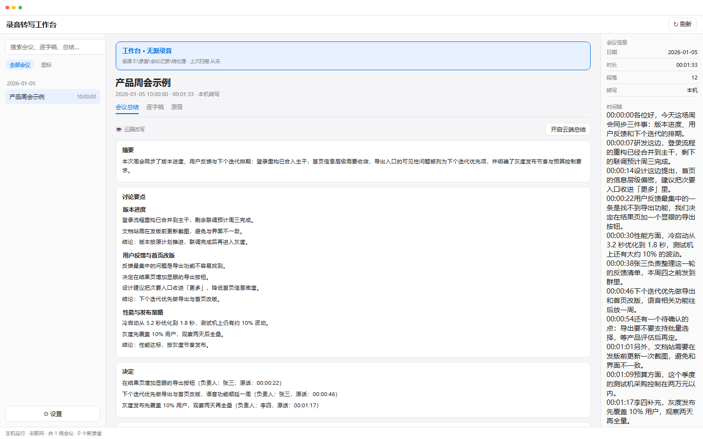

# 录音转写工作台

> 把手机录音变成可检索的会议纪要：**本机转写 → 总结 → 归档 → 搜索 → 回听原音**。
> 音频全程不出本机；只有在你主动开启「云端总结」时，转写**文字**才会发到你指定的服务。




---

## 这个工具解决什么

开会用手机录音，事后想找「上次谁提到预算」，通常只能翻一小时音频。本工具把这条链路自动化：

| 痛点 | 做法 |
|---|---|
| 转写要上传云端、按分钟收费 | 用 sherpa-onnx + SenseVoice 在本机转写，模型下载一次后断网可用 |
| 只有文字，没有结论 | 本机规则摘要兜底；可选接入任意 OpenAI 兼容接口做**改写式**会议纪要 |
| 记录散落各处 | 逐字稿与总结都存为普通 Markdown，Obsidian 可直接打开 |
| 想找原话找不到 | 全局关键词搜索（标题 + 逐字稿 + 总结），点时间戳直接跳到原音对应秒数 |
| 每次都要手动跑脚本 | 选一个录音文件夹，自动扫描新录音，工作台一键处理 |

## 主要功能

- **本机转写**：SenseVoice int8（中/英/日/韩/粤）+ Silero VAD 切句，30 秒分块处理，长录音内存稳定
- **三栏桌面界面**：原生窗口（pywebview + WebView2），左栏会议列表/搜索/星标，中栏工作台与会议详情，右栏信息/命中/时间轴
- **自动扫描**：任选录音目录，按 1/5/10/30/60 分钟扫描，按「路径 + 大小」去重
- **后台处理**：转写在后台线程执行，界面实时显示当前文件与百分比，不冻结
- **总结两档**：默认本机规则抽取（离线、零成本）；可选云端改写式总结（概述 / 讨论要点 / 决定 / 行动项 / 关键数字 / 待确认）
- **说话人半自动**：云端总结时从文本推断人名并挂到对应段落；推断不出显示 `—`，可手动改正并保存，不编造
- **并发安全**：录音处理与云端总结可同时进行，索引写入用文件锁 + 读最新合并，不会互相覆盖
- **同音纠错**：`同音纠错.txt` 维护人名/术语错写映射，转写时自动替换
- **离线优先**：无账号、无遥测；暗色/亮色、字号等偏好全部存本机

## 快速开始

### 1. 环境要求

- Windows 10/11（依赖 WebView2，Win11 自带）
- Python 3.13
- ffmpeg / ffprobe 在 PATH 中
- 约 300 MB 磁盘放模型；本机转写建议 8 GB 内存以上

```powershell
git clone https://github.com/xwmy13141314/recording-transcript-workbench.git
cd recording-transcript-workbench
python -m venv .venv
.venv\Scripts\python.exe -m pip install -r requirements.txt
```

ffmpeg 可用 `winget install Gyan.FFmpeg`，或到 [ffmpeg.org](https://ffmpeg.org/download.html) 下载后把 `bin` 加进 PATH。

### 2. 下载模型（只需一次）

```powershell
.venv\Scripts\python.exe scripts\setup_models.py
```

下载 SenseVoice int8（约 230 MB）与 Silero VAD，支持断点续传与镜像回退。完成后可断网使用。

### 3. 跑起来

```powershell
# 可选：导入脱敏示例会议，先看看界面长什么样
.venv\Scripts\python.exe scripts\init_demo.py

# 处理 会议记录\待处理\ 里的录音
.venv\Scripts\python.exe scripts\process.py

# 生成界面并打开（或直接跑桌面窗口）
.venv\Scripts\python.exe scripts\build_app.py
.venv\Scripts\python.exe scripts\desktop_app.py
```

### 4. 打包成 exe（可选）

```powershell
打包exe.bat
```

生成 `录音转写工作台.exe`（单文件，约 31 MB）。exe 需与 `会议记录\`、`模型\` 同级，别单独挪走。

## 使用流程

1. 双击 `录音转写工作台.exe`
2. 左下角 **⚙ 设置 → 录音目录**，选一个你放手机录音的文件夹
3. 把录音丢进该文件夹，工作台显示「发现 N 个新录音」，点 **全部处理**
4. 左栏搜关键词，中栏高亮命中原话，点时间戳跳原音
5. 想要更好的纪要：**设置 → AI 总结** 填 API Key，然后在会议页点 **云端重写总结**

> 处理后原音频会归档到 `会议记录\原始音频\YYYY-MM-DD\`，原目录不再保留。

## 隐私边界

| 环节 | 是否联网 |
|---|---|
| 音频解码、转写、VAD | 本机 |
| 本机规则总结 | 本机 |
| 扫描、索引、搜索 | 本机 |
| 模型首次下载 | 联网（仅一次） |
| 云端改写式总结（可选） | 上传**转写文字**到你配置的服务，音频不上传 |

API Key 只写入本机 `会议记录\设置.json`，界面不回显、不写日志、不内嵌进 HTML。仓库里所有会议数据、录音、Key 均为脱敏示例。

## 目录结构

```
recording-transcript-workbench/
├── scripts/
│   ├── config.py            路径与全局配置
│   ├── settings.py          设置读写、录音扫描、索引文件锁
│   ├── setup_models.py      下载 SenseVoice + VAD
│   ├── transcribe.py        sherpa-onnx 本机转写
│   ├── summarize.py         本机规则摘要
│   ├── cloud_summary.py     云端改写式总结 + 说话人推断（可选）
│   ├── process.py           处理流水线：转写 → 总结 → 归档 → 索引
│   ├── search.py            命令行关键词检索
│   ├── build_app.py         生成单文件界面 会议记录/工作台.html
│   ├── desktop_app.py       pywebview 桌面窗口与 JS API
│   ├── make_icon.py         生成应用图标
│   └── init_demo.py         导入脱敏示例数据
├── 示例数据/                 脱敏示例会议（索引 / 逐字稿 / 总结）
├── 图标/                    应用图标 PNG + 多尺寸 ICO
├── docs/screenshot.png      界面预览
├── 会议记录/                ← 你的数据（已被 .gitignore 排除）
│   ├── 待处理/              默认录音入口
│   ├── 原始音频/YYYY-MM-DD/ 归档原音
│   ├── 转写/                带时间戳逐字稿 .md
│   ├── 总结/                会议总结 .md
│   ├── 索引.json            结构化索引（搜索核心）
│   ├── 设置.json            应用设置（含 API Key，本机专用）
│   ├── 扫描状态.json        录音去重记录
│   └── 工作台.html          界面（由 build_app 生成）
├── PRD.md                   产品需求与验收
├── 使用说明.md               面向使用者的操作手册
├── ROADMAP.md               下一阶段功能评估
├── 选型对比.md               同类开源项目对比与选型理由
├── 同音纠错.txt              人名/术语纠错表
├── requirements.txt
└── 打包exe.bat / 启动工作台.bat
```

## 配置说明

`会议记录\设置.json` 主要字段：

| 字段 | 说明 | 默认 |
|---|---|---|
| `record_dir` | 录音目录，留空则用 `会议记录\待处理` | `""` |
| `auto_scan` | 启动/定时自动扫描 | `true` |
| `scan_interval` | 扫描间隔（分钟） | `5` |
| `on_new` | 发现新录音后 `prompt` 提示 / `auto` 自动处理 | `prompt` |
| `scan_subdirs` | 是否扫描子文件夹 | `true` |
| `theme` | `light` / `dark` / `system` | `light` |
| `font_scale` | 字号缩放 0.8~1.35 | `1.0` |
| `cloud_enabled` | 云端总结开关 | `false` |
| `cloud_base` | OpenAI 兼容接口地址 | `https://api.siliconflow.cn/v1` |
| `cloud_model` | 模型名 | `Qwen/Qwen2.5-7B-Instruct` |
| `cloud_api_key` | API Key（仅本机） | `""` |

任何 OpenAI 兼容服务都可用（硅基流动、DeepSeek、本地 vLLM / Ollama 的 OpenAI 兼容层等），改 `cloud_base` + `cloud_model` 即可。

## 常见问题

**Q：转写很慢？**
A：首次会加载模型，约几秒；之后 1 小时录音在普通 CPU 上通常几分钟。转写在后台跑，界面可以继续用。

**Q：点时间轴没声音？**
A：示例数据不含音频。真实录音处理后归档在 `会议记录\原始音频\`，点时间轴才会出声。

**Q：云端总结报错？**
A：先在设置里确认 `cloud_base`、`cloud_model`、API Key 三项；免费模型有速率限制，稍后重试或换模型。失败时会自动保留本机规则摘要。

**Q：说话人全是 `—`？**
A：文本里没出现明确称呼时不会猜。可在「逐字稿」页点标签手动指定并保存。

**Q：exe 双击没反应？**
A：看 `会议记录\启动日志.txt`。多为缺少 WebView2 运行时或 exe 被移出工作区目录。

## 技术栈

sherpa-onnx（SenseVoice int8 + Silero VAD）· ffmpeg · pywebview（WebView2）· PyInstaller · 纯 HTML/CSS/JS 单文件界面 · 无前端框架、无后端服务。

## 文档

- [PRD.md](PRD.md) — 需求、功能编号、验收标准、已知限制
- [使用说明.md](使用说明.md) — 安装到日常使用的完整操作手册
- [ROADMAP.md](ROADMAP.md) — 下一阶段功能评估与优先级
- [选型对比.md](选型对比.md) — 9 个同类开源仓库对比

## 已知限制

- 无自动声纹分离：说话人靠文本推断 + 手动对应
- 本机规则摘要为抽取式（原句拼接），质量一般；需要真纪要请用云端改写
- 识别准确率受录音质量影响，可用 `同音纠错.txt` 修正
- 界面为静态快照，处理完新录音点「↻ 刷新」即可，无需重新打包

## 许可

[MIT](LICENSE)
